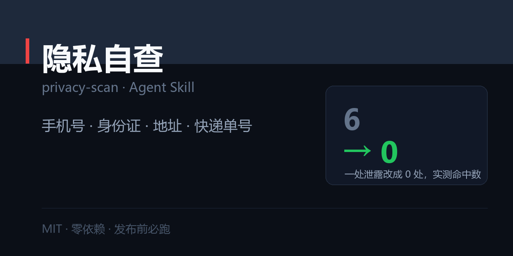

# 发布前隐私自查 · privacy-scan

> 发出去之前扫一遍：手机号、身份证、地址、快递单号。再给你一张截图必查 10 项清单。



[](./SKILL.md)
[](./LICENSE)
[](#)

---

## 一句话

```
$ python scripts/privacy_scan.py draft.md

命中 6 处：必删 2 · 建议删 3 · 看情况 1
结论：建议不发：有必删项，改完再发

  [必删] 完整手机号  第 1 行  13*******78（11 字符）
       风险：可被用于骚扰、撞库、社工
       处理：删掉或改为「私信我」；确需保留只留后四位
  [必删] 身份证号  第 4 行  11**************12（18 字符）
  [建议删] 快递单号  第 2 行  SF***********23（15 字符）
  [建议删] 门牌/房号  第 1 行  3号***2室（7 字符）
  [看情况] 微信号  第 3 行  微信************24（16 字符）
```

干净文本跑出来是 **0 处命中**。

---

## 为什么需要这个

泄露的往往不是你以为的东西。不是身份证号——是**外卖单号、工牌、房门牌、聊天截图顶部的备注名**。

而且**打码 ≠ 遮住**：半透明马赛克、局部涂抹、只遮中间四位，都能被还原或推断。

## 安装

```bash
git clone https://github.com/zhbehx/privacy-scan.git ~/.claude/skills/privacy-scan
```

## 用法

```bash
python scripts/privacy_scan.py draft.md              # 基础扫描
python scripts/privacy_scan.py draft.md --explain    # 看风险与处理建议
python scripts/privacy_scan.py draft.md --fail-on high   # 有必删项退出码 1
python scripts/privacy_scan.py draft.md --json
```

**报告里也不会打印完整值**——哪怕是帮你检查的时候，也不该再泄露一次。

## 扫什么

| 档位 | 类型 |
| --- | --- |
| 必删 | 身份证号 · 完整手机号 · 银行卡号 · 车牌号 |
| 建议删 | 邮箱 · 快递单号 · 详细地址 · 门牌房号 |
| 看情况 | 微信号 · QQ 号 · 内网域名/IP · 工号学号 · 完整生日 |

## 截图必查 10 项（脚本读不了图，这份清单补上）

1. 聊天截图顶部的**对方备注名**（常含真名 + 公司 + 职位）
2. **群名**（公司名 + 项目代号）
3. 头像（本人或家人照片）
4. 输入框里的**草稿文字**
5. 状态栏（时间、运营商、机型）
6. **通知横幅**（微信消息预览会露名字和内容）
7. 订单号 / 快递单号 / 房号
8. 背景（白板、门牌、工位贴纸）
9. 反光与倒影
10. **EXIF**（GPS 坐标、设备、拍摄时间）

详细做法见 [`references/screenshot-checklist.md`](./references/screenshot-checklist.md)。

## 一个 30 秒总检查

1. 这张图里有我的名字吗？
2. 有我家或公司的位置吗？
3. 陌生人拿着这张图，能不能找到我？

三句有一句答「能」，就再改一遍。

## 仓库结构

```
privacy-scan/
├── SKILL.md                          # 三原则 + Step 0–5 + 三档处理 + 反模式
├── references/
│   └── screenshot-checklist.md       # 截图必查 10 项 + 三档原则 + 30 秒总检查
├── scripts/
│   └── privacy_scan.py               # 12 类敏感信息扫描 + 自动打码输出
├── examples/
│   └── 01-pre-publish.md             # 完整检查报告
└── market/social-preview.png
```

## 三个诚实的局限

1. **读不了图片。** 只能扫文本，截图必须人工对照清单。
2. **规则式匹配，会有漏。** 手写体、艺术字、图片里的文字它都看不到。
3. **不判断「该不该发」。** 它只告诉你哪些信息敏感，发不发是你的判断。

## 相关 skill

- **内容与写作**：[爆款文案工坊](https://github.com/zhbehx/viral-copy) · [AI 味检测器](https://github.com/zhbehx/ai-tell)
- **职场五件套**：[简历对岗改写](https://github.com/zhbehx/resume-tailor) · [面试陪练](https://github.com/zhbehx/interview-coach) · [汇报写作](https://github.com/zhbehx/weekly-report) · [PPT 叙事大纲](https://github.com/zhbehx/slide-story) · [会议纪要](https://github.com/zhbehx/meeting-actions)
- **避坑与决策**：[JD 红旗检测](https://github.com/zhbehx/jd-redflag) · [合同风险扫描](https://github.com/zhbehx/contract-redflag) · [会议成本](https://github.com/zhbehx/meeting-cost)
- **发布与沟通**：[职场语气](https://github.com/zhbehx/tone-check)

共同点：零依赖、中文优先、每个都带一个确定性检查脚本。

## 自定义

1. **加你们的内部标识**：`scripts/privacy_scan.py` 的 `RULES` 里加一条正则。
2. **改档位**：`high`/`mid`/`low` 决定处理建议的严厉程度，也影响 `--fail-on` 行为。
3. **接入发布流程**：`--fail-on high` 挂进 pre-commit 或 CI。

## FAQ

**Q：我的手机号本来就是公开的（比如做业务），还要扫吗？**
A：看你发到哪。公开平台留手机号还可能违反平台规则。脚本会提示，判断权在你。

**Q：为什么报告里要把号码打码？**
A：帮你检查的过程本身也可能泄露——如果这份报告被截图转发，完整号码就又多了一份副本。

**Q：马赛克不行吗？**
A：小面积马赛克可以被部分还原，且容易漏边缘。**整块涂黑或裁掉**才可靠。

## License

[MIT](./LICENSE)

---

本仓库是 [zhbehx 的 Agent Skill 合集](https://github.com/zhbehx) 之一。

觉得有用就点个 ⭐，是我继续加词库、加行业的动力。

<!-- zhbehx-collection-footer -->
